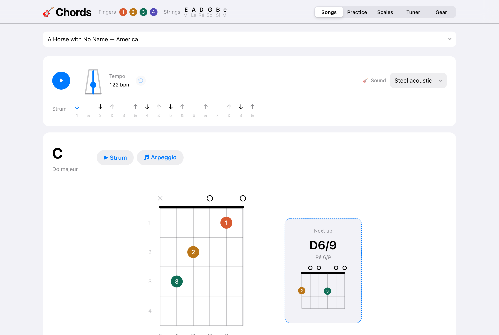
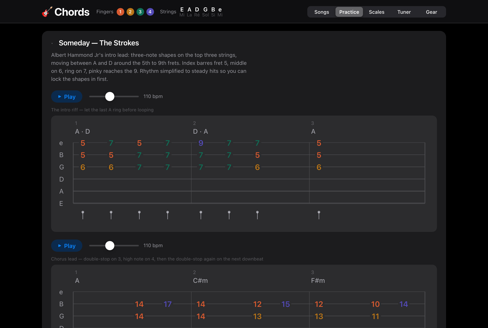
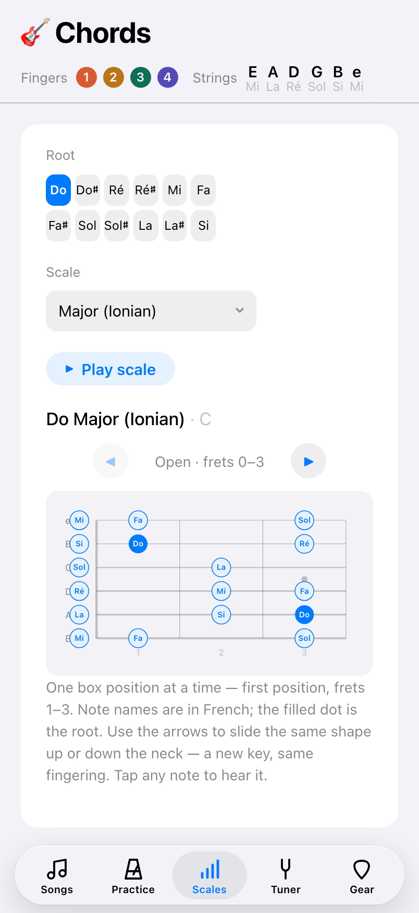
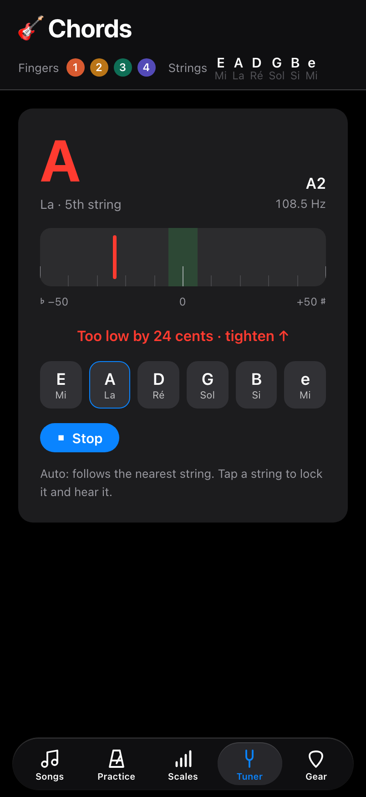
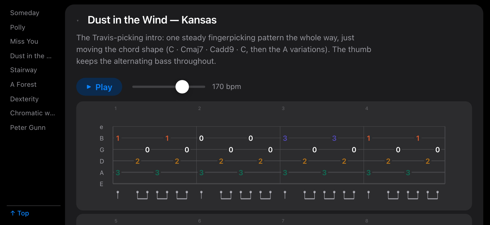

# Chords 🎸

A guitar chord visualizer and practice tool. Live at [chords.vumble.dev](https://chords.vumble.dev).

Built with Vite, React, and TypeScript.

## Screenshots

**Songs:** play along with a chord progression, with the strum pattern, tempo and a next-up chord.



**Practice:** tabs for riffs and exercises, with finger colours, a rhythm lane and a play button with adjustable tempo.



**Scales and Tuner on a phone:** scale boxes with French note names, and a microphone tuner with a cents meter.

|                                        Scales                                         |                                                         Tuner                                                          |
| :-----------------------------------------------------------------------------------: | :--------------------------------------------------------------------------------------------------------------------: |
|  |  |

**Landscape on a phone:** the Practice index on the left jumps straight to a card.



## Features

- 28 common chords: open majors and minors, barre shapes, dominant/minor/major 7ths, sus and add chords
- Classic chord-chart fretboard diagrams with finger numbers, open/muted string markers, and barre indicators
- French chord names (Do, Ré, Mi…) alongside the English ones
- Real guitar sound via [soundfont-player](https://github.com/danigb/soundfont-player) with a choice of steel, nylon, clean electric, or jazz electric, and a Web Audio synth fallback while samples load
- Practice songs: built-in progressions with a looping play-along at adjustable tempo — strum on beat 1, metronome ticks on 2–4, the diagram follows the current bar and a next-up card shows the upcoming chord
- Keyboard navigation: `←` / `→` to change chord (or jump bars while a song plays), `space` to strum, `a` for one-by-one
- State persisted to localStorage: selected chord, filter, song, and tempo survive reloads
- Light and dark mode (follows system preference)

## Development

```sh
npm install
npm run dev     # dev server on :5180
npm run build   # type-check + production build to dist/
npm test        # vitest (pure logic: chord names, barres, note math)
```

## Deployment

Deployed on Vercel (framework preset: Vite). Pushes to `main` auto-deploy via the Vercel git integration.
