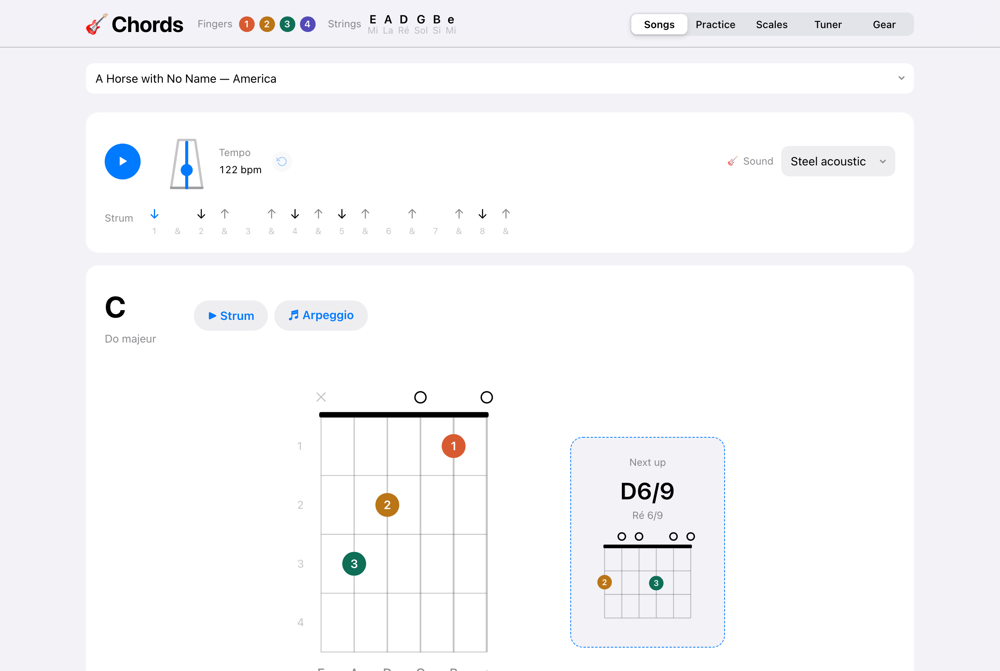
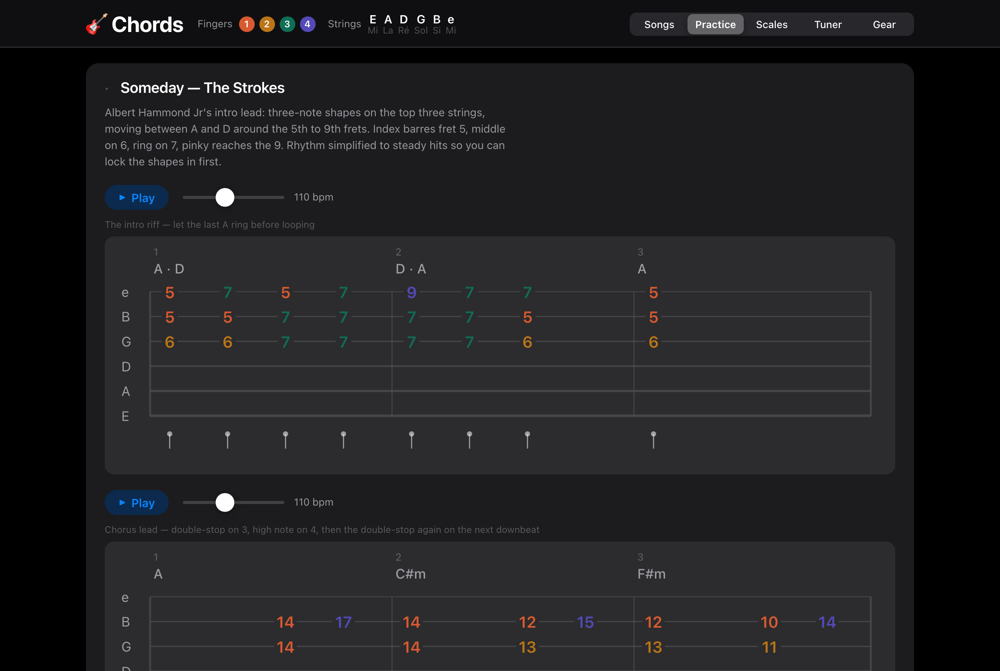
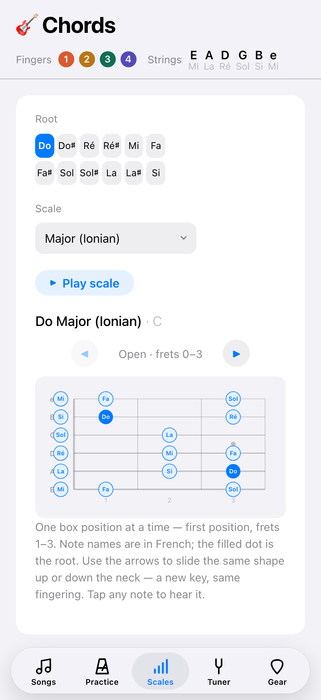
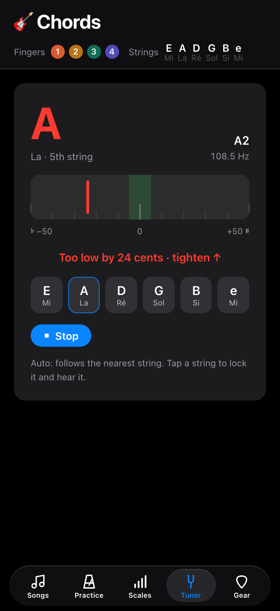
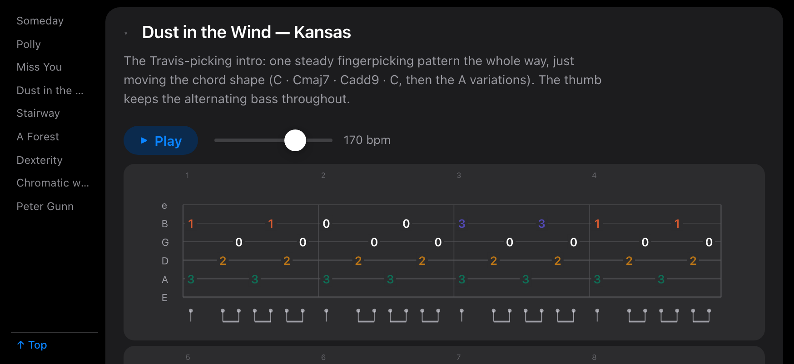

# Chords 🎸

A guitar chord visualizer and practice tool. Live at [chords.vumble.dev](https://chords.vumble.dev).

Built with Vite, React, and TypeScript.

## Screenshots

**Songs:** play along with a chord progression, with the strum pattern, tempo and a next-up chord.



**Practice:** tabs for riffs and exercises, with finger colours, a rhythm lane and a play button with adjustable tempo.



**Scales and Tuner on a phone:** scale boxes with French note names, and a microphone tuner with a cents meter.

|                                        Scales                                         |                                                         Tuner                                                          |
| :-----------------------------------------------------------------------------------: | :--------------------------------------------------------------------------------------------------------------------: |
|  |  |

**Landscape on a phone:** the Practice index on the left jumps straight to a card.



## Features

**Songs**

- 11 songs grouped by difficulty, each with its own tempo, strum pattern (including two-bar patterns) or fingerpicking, 6/8 where needed, and a capo badge
- Looping play-along: the chord diagram follows the current bar, a next-up card shows the coming chord, and a sweeping marker follows the strum pattern
- Drag across the bar chips to loop a section; drag the metronome to change tempo
- Chord library of 32 chords (open majors and minors, barre shapes, 7ths, sus and add chords) with filters, finger-coloured diagrams, open/muted string markers and barre indicators
- French chord names (Do, Ré, Mi…) next to the English ones

**Practice**

- Tabs for riffs and exercises: She's Lost Control, Someday, Polly, Miss You, Dust in the Wind, Stairway to Heaven, A Forest, Peter Gunn, plus hammer-on and pull-off routines and chromatic, staircase, dexterity and spider drills
- Finger colours on every note, slurs for hammer-ons and pull-offs, a rhythm lane with beamed note values, and play/stop with an adjustable tempo per tab
- Practice tools on every tab: a count-in, a loop over chosen bars, and a speed trainer (+5 bpm each loop)
- A practice log on the device: time today, total and streak per card and overall
- Cards fold away and remember it; an index on the side (desktop and phone landscape) follows the card being read and jumps straight to one; `/practice#<card>` links to a single card

**Scales**

- Minor and major pentatonic, major, natural minor and blues, in any key, shown one box position at a time with French note names
- Slide the box along the neck, tap a note to hear it, or play the whole scale

**Tuner**

- Microphone tuner: picks the nearest string, shows how many cents sharp or flat you are, and tells you to tighten or loosen
- Tap a string to lock onto it and hear its reference note; a level meter shows the mic is hearing you

**Gear**

- Your guitars and amp with specs, prices, and how old the strings are

**Everywhere**

- Real guitar sound via [soundfont-player](https://github.com/danigb/soundfont-player) with 8 sounds (steel and nylon acoustic, clean, jazz, muted, overdriven and distorted electric, harmonics) and a Web Audio fallback while samples load
- Liquid Glass look in light and dark mode (follows the system): frosted cards over a sunset backdrop, a tab bar with a lens under the current tab; built for iPhone in portrait and landscape, with a home screen icon
- Keyboard shortcuts: `←` / `→` to change chord (or jump bars while a song plays), `space` to play or pause, `s` to strum, `a` for an arpeggio
- Choices are saved in the browser (chord, song, tempo, sound, folded cards, scale), so they survive a reload
- Works offline once visited: the app and every guitar sound played once are kept by a service worker
- Each tab has its own address (`/practice`, `/scales`, `/tuner`, `/gear`)

## Development

```sh
npm install
npm run dev     # dev server on :5180
npm run build   # type-check + production build to dist/
npm test        # vitest (pure logic: chord names, note math, tab helpers, practice log, checks on every tab)
```

## Deployment

Deployed on Vercel (framework preset: Vite). Pushes to `main` auto-deploy via the Vercel git integration.
